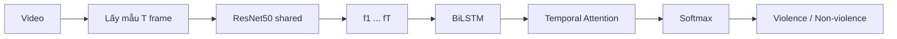

# Phát hiện hành vi bạo lực trong video
## CNN–LSTM kết hợp đặc trưng không gian – thời gian

Hệ thống phân loại video thành **violence** / **non_violence** bằng mô hình học sâu hai khối:

- **Không gian (spatial):** ResNet50 trích đặc trưng hình ảnh trên từng frame (dáng người, hiện trường, đối tượng).
- **Thời gian (temporal):** BiLSTM + attention mô hình chuỗi frame, nắm động tác diễn ra theo thời gian (đấm, đá, xô đẩy).

---

## 1. Phát biểu bài toán

Cho video \(V = \{x_1, x_2, \ldots, x_N\}\), cần dự đoán nhãn \(y \in \{0,1\}\) (không bạo lực / bạo lực) và xác suất \(p(y=1 \mid V)\).

Đặc trưng thuần không gian (ảnh tĩnh) dễ nhầm cảnh căng thẳng với hành động thật. Đặc trưng thuần thời gian (chuyển động) dễ nhầm thể thao, nhảy, chạy. Khóa luận kết hợp cả hai.

---

## 2. Hướng giải quyết

Kiến trúc **CNN + BiLSTM + Temporal Attention** phù hợp khóa luận vì:

1. CNN 2D pretrained ImageNet tận dụng được bộ dữ liệu nhỏ (Hockey Fight, RLVS, RWF-2000).
2. LSTM giải thích được “chuỗi hành động”, đúng tiêu chí *không gian–thời gian*.
3. Attention cho phép minh họa frame nào quyết định kết quả — hữu ích khi bảo vệ.
4. Nhẹ hơn I3D / SlowFast, huấn luyện được trên GPU thông thường.



Công thức gọn:

\[
f_t = \mathrm{ResNet50}(x_t),\quad
H = \mathrm{BiLSTM}(f_{1:T}),\quad
z = \sum_t \alpha_t h_t,\quad
\hat{y} = \mathrm{softmax}(W z)
\]

\(\alpha_t\) là trọng số attention tại frame \(t\).

---

## 3. Luồng xử lý (từng bước)

Mỗi bước là một script, chạy lần lượt:

```bash
python -m src.pipeline.run --config configs/demo.yaml
```

Hoặc từng bước:

```bash
python -m src.pipeline.step01_collect
python -m src.pipeline.step02_preprocess
python -m src.pipeline.step03_clips
python -m src.pipeline.step04_spatial
python -m src.pipeline.step05_temporal
python -m src.pipeline.step06_train
python -m src.pipeline.step07_evaluate
python -m src.pipeline.step08_infer
```

`configs/demo.yaml` tạo 20 video tổng hợp để chạy thử trên CPU. Khi có dataset thật, đặt video vào `data/raw/` và dùng `configs/default.yaml`.

| Bước | Việc làm | Script | Kết quả |
|------|----------|--------|---------|
| 1 | Thu thập / kiểm kê video 2 lớp | `step01_collect` | `step01_inventory.csv` |
| 2 | Trích frame + chia 70/15/15 | `step02_preprocess` | `data/processed`, `data/splits` |
| 3 | Lấy mẫu T frame, resize, chuẩn hóa | `step03_clips` | `data/clips/*.pt` |
| 4 | CNN không gian ResNet50 → 2048-D | `step04_spatial` | `data/features/*.npy` |
| 5 | BiLSTM + attention (kiểm tra forward) | `step05_temporal` | `step05_attention_untrained.png` |
| 6 | Huấn luyện LSTM trên đặc trưng đã cache | `step06_train` | `checkpoints/best.pt` |
| 7 | Accuracy, F1, AUC, confusion matrix | `step07_evaluate` | `step07_metrics.json` |
| 8 | Suy luận cửa sổ trượt | `step08_infer` | `prediction.json` |

### Bước 1 — Dữ liệu

Đặt video theo cấu trúc:

```
data/raw/
  violence/
    clip001.mp4
  non_violence/
    clip001.mp4
```

Bộ dữ liệu thường dùng cho khóa luận:

- **Hockey Fight** (~1000 clip, cân bằng)
- **Movies Fight** (bạo lực điện ảnh)
- **RLVS** — Real Life Violence Situations (2000 clip)
- **RWF-2000** (camera giám sát)

### Bước 2 — Tiền xử lý

```bash
python -m src.prepare_dataset --config configs/default.yaml
```

Tạo `data/processed/<class>/<video_id>/*.jpg` và `data/splits/{train,val,test}.csv`.

Chỉ dùng file video gốc, không trích sẵn frame:

```bash
python -m src.prepare_dataset --no-extract
```

### Bước 3–6 — Huấn luyện

```bash
python -m src.train --config configs/default.yaml
```

Checkpoint tốt nhất: `checkpoints/best.pt`. Đường cong loss/F1: `reports/outputs/training_curves.png`.

Backbone dùng learning rate nhỏ hơn LSTM (`backbone_lr`) để không phá đặc trưng ImageNet.

### Bước 7 — Đánh giá

```bash
python -m src.evaluate --checkpoint checkpoints/best.pt --split test
```

### Bước 8 — Suy luận

Video dài được cắt cửa sổ 16 frame, bước 8 frame. Nhãn cuối = trung bình xác suất các clip, so với ngưỡng 0.5.

```bash
python -m src.infer --video path/to/video.mp4 --checkpoint checkpoints/best.pt
```

Kết quả: `reports/outputs/infer/prediction.json` và ảnh attention `attention_best_clip.png`.

---

## 4. Cài đặt

Cần Python 3.10+ và (khuyến nghị) GPU CUDA.

```bash
cd violence-detection
python -m venv .venv
.venv\Scripts\activate
pip install -r requirements.txt
```

Kiểm tra mô hình chạy được (không cần dataset):

```bash
python -m src.smoke_test
```

---

## 5. Cấu hình chính (`configs/default.yaml`)

| Tham số | Mặc định | Ý nghĩa |
|---------|----------|---------|
| `data.num_frames` | 16 | Độ dài clip T |
| `data.image_size` | 224 | Kích thước frame |
| `model.backbone` | resnet50 | CNN không gian |
| `model.lstm_hidden` | 512 | Số đơn vị LSTM |
| `model.bidirectional` | true | BiLSTM |
| `model.use_attention` | true | Attention thời gian |
| `model.freeze_backbone` | false | Đóng băng CNN (GPU yếu: đặt `true`) |
| `train.batch_size` | 8 | Giảm còn 4 nếu hết VRAM |
| `infer.threshold` | 0.5 | Ngưỡng violence |

---

## 6. Cấu trúc mã nguồn

```
violence-detection/
  configs/default.yaml
  src/
    prepare_dataset.py
    train.py
    evaluate.py
    infer.py
    models/cnn_lstm.py
    data/preprocess.py
    data/dataset.py
    data/transforms.py
    utils/
  data/raw/
  data/processed/
  data/splits/
  checkpoints/
  reports/outputs/
```

---

## 7. Gợi ý viết khóa luận

- **Chương cơ sở lý thuyết:** CNN, LSTM, attention, đặc trưng không gian vs thời gian.
- **Chương phương pháp:** đúng pipeline 8 bước và sơ đồ kiến trúc ở mục 2–3.
- **Chương thực nghiệm:** so sánh (1) chỉ CNN + pooling, (2) CNN–LSTM, (3) CNN–LSTM–Attention; báo cáo F1 và AUC trên test.
- **Hạn chế:** lấy mẫu đều có thể bỏ qua hành động rất ngắn; dữ liệu nhỏ dễ overfit; nhầm với thể thao đối kháng.

Hướng mở rộng nếu còn thời gian: optical flow (two-stream), I3D, SlowFast, hoặc fusion attention giữa RGB và chuyển động.
